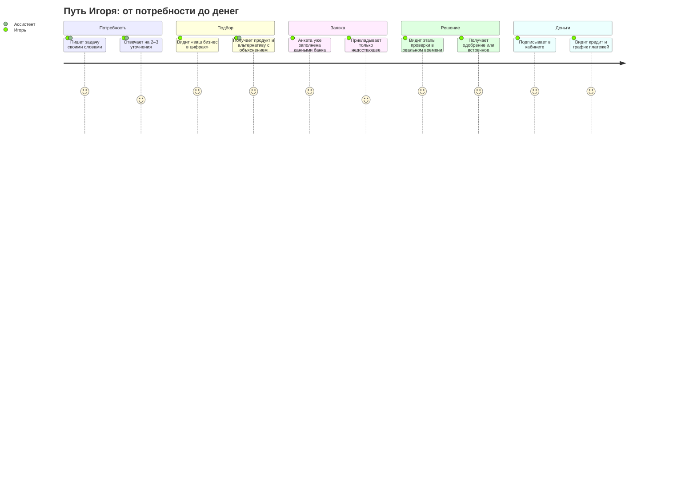
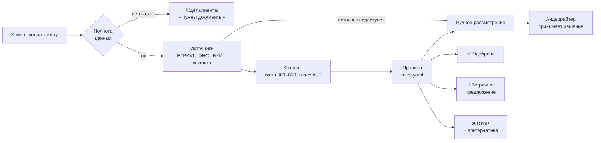
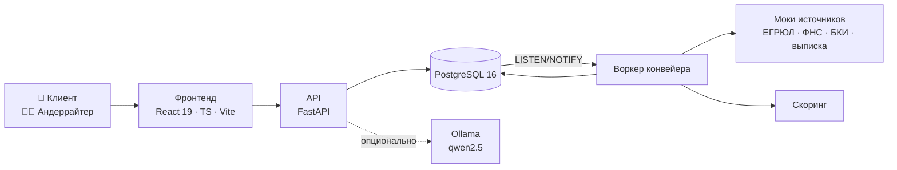

# Умный кредитный кабинет предпринимателя

**Кабинет для малого и микробизнеса с ИИ-ассистентом. Клиент описывает задачу своими словами
и с помощью ассистента доходит от «нужны деньги на закупку» до денег на счёте: без звонков,
без походов в отделение и без лишних отказов в кредитной истории.**

Хакатон Альфа-Банка · направление ММБ · кейс «Умный кредитный кабинет предпринимателя»

[Проблема](#-1-проблема) · [Решение](#-3-решение) · [Фичи](#-5-главные-фичи) · [Демо за 4 минуты](#-10-демо-за-4-минуты) · [**Как запустить**](#-11-как-запустить) · [Архитектура](#-12-как-это-устроено) · [📊 Презентация](<Кредитный_кабинет_—_презентация_продукта.pdf>)


## 📉 1. Проблема

> **Предприниматель думает задачей, а банк говорит продуктами.**

У владельца малого бизнеса нет финансиста. Он не знает, нужен ему овердрафт или кредитная линия,
одобрят ли заявку и сколько платёж будет стоить его бизнесу. Каждый отказ остаётся в кредитной истории.

| Факт рынка (2026) | Что это значит для клиента |
| --- | --- |
| Через агрегатор «Сравни» в III кв. одобрено **1,4 %** заявок МСП (Инк.) | Подать «вслепую» — почти наверняка получить отказ |
| **51 %** кредитов МСП привязаны к ключевой ставке (НКР) | Платёж непредсказуем, нагрузку сложно оценить |
| Просрочка у **каждого шестого** заёмщика МСП, дефолтность микробизнеса выросла с 8,1 до 9,9 % (НКР) | Банку нужен клиент, которому платёж по силам |
| Решение по заявке приходит **до 48 часов**, и всё это время клиент ничего о ней не знает (myfin) | «Что с моей заявкой?» — звонки в колл-центр |

Источники с датами — в [продуктовой концепции](Концепция/).

---

## 👥 2. Для кого

Владелец бизнеса, который сам решает, где взять деньги. Мы взяли четырёх типичных клиентов, и каждый из них есть в демо:

| | Клиент | Задача своими словами | Что покажет кабинет |
| --- | --- | --- | --- |
| 🛒 | **Игорь**, ООО «Дом и уют», селлер на маркетплейсах | «До распродаж нужно закупить партию, а выплата от маркетплейса придёт через две недели» | Полный путь: от диалога до денег на счёте, с ручным рассмотрением и встречным предложением |
| ☕ | **Анна**, ИП, кофейня | «В декабре зарплата и аренда наступают раньше, чем придут деньги за корпоративы» | Автоматическое одобрение овердрафта без участия андеррайтера |
| 🪑 | **Марина**, ООО «Лён и Дуб», мебельное производство | «Выиграли тендер, нужно обеспечение и новый станок» | Банк запросил документ → дозагрузка → повторное рассмотрение |
| 🔧 | **Сергей**, ИП | — | Отказ, но с понятной причиной: видно, какое правило не прошло |

И пятый пользователь, со стороны банка: **Ольга, андеррайтер**. Ей нужно разбирать заявки быстро и не терять в них данные.

---

## 💡 3. Решение

**Кабинет закрывает каждую точку, где сегодня клиент теряется или уходит, а ассистент связывает этапы в один разговор.**



| Боль клиента | Как сегодня | Что в нашем кабинете |
| --- | --- | --- |
| «Не понимаю, что мне нужно» | Каталог продуктов с банковскими терминами | Задача свободным текстом, ассистент сам сопоставляет её с продуктом |
| «Одобрят ли?» | Подать и ждать | Предварительная оценка по данным счёта **до подачи** |
| «Сколько это стоит бизнесу?» | Ставка в процентах, остальное считай сам | Платёж поверх реальных оборотов: «платёж — 12 % вашего среднего потока» |
| «Собирать документы долго» | Длинная анкета, всё вводится вручную | Анкета предзаполнена данными банка, видно, каких документов не хватает |
| «Не знаю, что с заявкой» | Тишина до 48 часов | Трекер с этапами проверки и уведомления |
| «Отказали — и что дальше?» | Клиент уходит к конкуренту | Причина простыми словами: понятно, что исправить перед новой заявкой |

---

## 🤖 4. ИИ-ассистент: консультант, а не чат-бот с FAQ

Ассистент живёт в боковой панели на десктопе и в полноэкранном чате на телефоне, и всегда знает, на каком экране находится клиент.

- **Понимает задачу.** Разбирает свободный текст, задаёт не больше 3–4 уточнений: цель, сумма, когда нужны деньги, из чего вернёте. С подключённой моделью; в режиме правил отвечает по ключевым словам.
- **Смотрит на бизнес.** Остаток, поступления, действующие кредиты и безопасный платёж он берёт из выписки по счёту.
- **Объясняет простыми словами.** Обращается на «вы», говорит коротко, без жаргона, каждую цифру переводит на язык бизнеса.
- **Ведёт до конца.** Подсказывает статус, предупреждает о запросе документов, есть действие «Открыть заявку».

> 🛡 **Ассистент не может выдумать ставку или пообещать одобрение.**
> Языковая модель отвечает только за разговор. Числа (остаток, платёж, статус, причина решения)
> она берёт из бэкенда через инструменты, а решение по кредиту принимают скоринг и правила банка, не LLM.
> Если модель недоступна, ассистент автоматически переходит на ответы по правилам, и демо не падает.

---

## ✨ 5. Главные фичи

### Для предпринимателя

| | Фича | Что получает клиент |
| --- | --- | --- |
| 🏠 | **Главная с деньгами бизнеса** | Остаток, поступления, график денежного потока за 12 месяцев, действующие кредиты |
| 💬 | **Подбор через диалог** | Описывает задачу словами или выбирает цель, ассистент уточняет параметры |
| 🎯 | **Рекомендация «почему именно это»** | Основной продукт и альтернатива, расчёт платежа и шкала нагрузки на поток |
| 🧮 | **Калькулятор нагрузки** | Платёж сравнивается с реальным средним чистым потоком по счёту, а не с абстрактным доходом |
| 📝 | **Анкета в 4 шага** | Параметры → компания → финансы и документы → проверка; данные банка подставлены заранее |
| 📎 | **Документы с проверкой** | PDF/JPG/PNG до 10 МБ, проверка типа и размера до отправки |
| 📍 | **Статус-трекер** | Этапы конвейера видны в реальном времени, статус обновляется без перезагрузки страницы |
| ✅ | **Четыре исхода решения** | Одобрено · встречное предложение · запрос документов · отказ с причиной |
| ✍️ | **Подписание и выдача** | Принять условия, подписать, сразу увидеть кредит и график платежей |
| 🔔 | **Уведомления** | На каждый важный статус заявки |
| 📱 | **Адаптив** | Мобильная навигация и полноэкранный чат ассистента |

### Для банка

| | Фича | Что получает андеррайтер |
| --- | --- | --- |
| 📥 | **Очередь заявок** | Счётчики «новые / в конвейере / ручные / ждут клиента / решённые», поиск по ИНН и номеру |
| 🗂 | **Карточка заявки** | Вкладки: сводка, клиент, проверки источников, риск и скоринг, документы, история |
| ⚖️ | **Панель решения** | Одобрить, сделать встречное предложение, запросить документы или отказать; платёж пересчитывается сразу |
| 🔄 | **Автоматический конвейер** | ЕГРЮЛ, ФНС, БКИ и выписка → скоринг → правила → рекомендация андеррайтеру |
| 📜 | **Правила без программиста** | Пороги лежат в `rules.yaml`, их можно менять без правки кода |
| 🔐 | **Аудит** | Каждое действие записано: кто, когда, что было и что стало |
| 🩺 | **Здоровье источников** | Видно, какой внешний сервис тормозит или лежит |

---

## ⚙️ 6. Как принимается решение

**Заявка проходит конвейер автоматически, а человек подключается только там, где без него нельзя.**



- **Автоодобрение.** Сумма до 1 млн ₽, класс риска A или B, все правила и источники в порядке.
- **Встречное предложение.** Если платёж съедает слишком большую долю потока, банк предлагает сумму или срок, которые бизнес выдержит.
- **Стоп-правила.** Ликвидация по ЕГРЮЛ, просрочка в БКИ больше 60 дней, класс E.
- **Прозрачный скоринг.** Учитываются возраст бизнеса, выручка, налоговый долг, просрочки, запросы в БКИ, доля маркетплейсов, долговая нагрузка. Андеррайтер видит балл, класс риска и результат каждого правила.

---

## 🛡 7. Устойчивость: демо, которое нельзя сломать

Внешние сервисы банка отказывают в реальной жизни, и кабинет к этому готов:

- Источник не ответил: 3 попытки с таймаутом 3 с, затем заявка уходит на ручное рассмотрение с пометкой «Источник недоступен». **Заявка не теряется.**
- Воркер упал посреди обработки: после перезапуска он сам находит зависшие заявки и доводит их до конца.
- LLM недоступна: ассистент переключается на ответы по правилам.
- Статус меняет только машина состояний. Недопустимый переход (например, «черновик → одобрено») невозможен: на него бэкенд отвечает 409.

> 🎛 **Режим проверки для жюри.** Кнопка с пунктиром внизу меню. Можно войти любым пользователем,
> ускорить конвейер, «уронить» БКИ или ФНС прямо во время демо и вернуть настройки стенда.

---

## 📈 8. Ценность для бизнеса и банка

**Предприниматель понимает, что брать и сколько это будет стоить бизнесу, и не копит лишние отказы в кредитной истории.**
**Банк получает больше качественных заявок при меньшем объёме ручной работы.**

| Метрика банка | Что на неё влияет | Где видно в демо |
| --- | --- | --- |
| Конверсия «начал → подал» | Задача своими словами, предзаполненная анкета | Игорь подаёт заявку, почти ничего не вводя вручную |
| Доля одобрений | Сумма подобрана под реальный денежный поток | Встречное предложение с безопасным платежом |
| Время до денег | Полный пакет данных с первого раза | Конвейер проходит за минуты, а не за 48 часов |
| Заявки без дозапроса | Проверка комплектности до отправки | Ассистент называет недостающее заранее |
| Обращения «что с заявкой?» | Прозрачный статус | Трекер этапов и уведомления |
| Качество портфеля | Платёж проверен на потоке ещё до подачи | Шкала нагрузки в калькуляторе и в панели андеррайтера |
| Удержание после отказа | Альтернатива вместо тупика | Сценарий Сергея |

---

## 🎨 9. Дизайн-система

Своя дизайн-система «Кредитный кабинет»: токены, компоненты React, светлая и тёмная тема, правила тона и форматирования денег.

| Светлая | Тёмная |
| --- | --- |
|  |  |

Превью всех компонентов: откройте `Дизайн-система/preview/index.html` в браузере.

---

## 🎬 10. Демо за 4 минуты

| Время | Что показываем | Кто |
| --- | --- | --- |
| 0:00–0:40 | Проблема: рынок МСП-кредитования в цифрах | слайд |
| 0:40–1:50 | Игорь описывает задачу, ассистент уточняет и показывает «ваш бизнес в цифрах» | `igor.sokolov` |
| 1:50–2:30 | **Вау-момент:** продукт подобран под безопасный платёж, видно «почему это» | `igor.sokolov` |
| 2:30–3:00 | Анкета, отправка заявки, этапы конвейера в реальном времени | `igor.sokolov` |
| 3:00–3:40 | Со стороны банка: очередь, карточка, скоринг, правила. Андеррайтер делает встречное предложение | `olga.kravtsova` |
| 3:40–4:00 | У Игоря решение появилось без перезагрузки: принимает, подписывает, видит кредит. Ценность для банка и что дальше | `igor.sokolov` |

Если останется время: уронить БКИ в «Режиме проверки» и показать, что заявка не теряется, а уходит на ручное рассмотрение.
Запасные сценарии: Анна (автоодобрение), Марина (дозапрос документов), Сергей (отказ с причиной).

---

## 🚀 11. Как запустить

**Нужно:** Docker и Docker Compose. Больше ничего.

```bash
docker compose up --build
```

Через минуту откройте **<http://localhost:3000>**. Всё поднимается одной командой: кабинет, API, воркер конвейера, PostgreSQL и моки внешних источников.

На экране входа нужного пользователя выбирают кликом, пароль подставляется сам.

| Логин | Кто | Что показывает | Пароль |
| --- | --- | --- | --- |
| `igor.sokolov` | Игорь, ООО «Дом и уют» | Ручное рассмотрение, встречное предложение, подписание | `demo123` |
| `anna.belova` | Анна, ИП | Автоматическое одобрение | `demo123` |
| `marina.orlova` | Марина, ООО «Лён и Дуб» | Запрос дополнительных документов | `demo123` |
| `sergey.fomin` | Сергей, ИП | Отказ с причиной | `demo123` |
| `olga.kravtsova` | Ольга, андеррайтер | Консоль банка | `demo123` |

### Быстрая проверка за 3 минуты

1. Войдите как **Анна** → «Финансирование» → цель «Кассовый разрыв», 600 000 ₽ на 12 месяцев → «Показать варианты» → «Оформить заявку».
2. Пройдите анкету, отметьте согласия, отправьте. Через несколько секунд заявка одобрена автоматически: примите условия и подпишите.
3. Войдите как **Игорь**, подайте заявку на 3 000 000 ₽ на 18 месяцев. Конвейер передаст её специалисту.
4. Войдите как **Ольга**: откройте заявку, посмотрите проверки, скоринг и правила, возьмите в работу и примите встречное предложение.
5. Вернитесь к **Игорю**: решение появится без перезагрузки. Примите его и подпишите, и кредит появится в «Мои кредиты».

### Полезные адреса

| Что | Где |
| --- | --- |
| Кабинет | <http://localhost:3000> |
| API и Swagger | <http://localhost:8000/docs> |
| Проверка, что API жив | <http://localhost:8000/health> |
| Состояние моков источников | <http://localhost:8090/_admin/sources> |

### Режим проверки: ускорить конвейер и «сломать» источник

Кнопка с пунктиром внизу меню. Чтобы этапы шли быстрее, выберите там быструю скорость. Там же можно «уронить» внешний источник и посмотреть, как заявка уходит на ручную проверку, а потом вернуть настройки.

То же без интерфейса:

```bash
# уронить БКИ
curl -X POST localhost:8090/_admin/sources/bki -H 'content-type: application/json' -d '{"mode":"down"}'

# вернуть всё как было
curl -X POST localhost:8000/demo/reset

# полный сброс базы
docker compose down -v && docker compose up --build
```

### Настоящая LLM вместо ответов по правилам

По умолчанию ассистент отвечает по правилам. Чтобы включить открытую модель через [Ollama](https://ollama.com):

```bash
ollama pull qwen2.5:3b-instruct
ASSISTANT_OLLAMA_URL=http://host.docker.internal:11434 docker compose up -d
```

`ASSISTANT_MODE` задаёт режим: `auto` — модель, а если она недоступна, правила (по умолчанию); `llm` — только модель; `rules` — только правила.

### Если что-то не стартует

- **Порт 5432 занят** локальным Postgres: создайте в корне `docker-compose.override.yml` (он в `.gitignore`) и запустите снова:

  ```yaml
  services:
    db:
      ports: !override
        - "5433:5432"
  ```
- **Только интерфейс, без Docker и бэкенда:** `cd frontend && npm ci && VITE_API_MODE=mock npm run dev`, пароль тестовых пользователей в этом режиме `demo-2026`. Нужен Node.js 22.12+.

---

## 🏗 12. Как это устроено



| Слой | Технологии |
| --- | --- |
| Фронтенд | React 19, TypeScript (strict), Vite, React Router 7, TanStack Query, Feature-Sliced Design, типы генерируются из OpenAPI |
| Бэкенд | Python 3.12, FastAPI, SQLAlchemy 2, Alembic, PostgreSQL 16, JWT |
| Конвейер | Отдельный воркер, очередь на `SELECT … FOR UPDATE SKIP LOCKED` + `LISTEN/NOTIFY`, ретраи и восстановление после сбоя |
| Ассистент | Вызов инструментов бэкенда, Ollama (опционально), запасной режим на правилах |
| Качество | pytest, ruff, oxlint, CI в GitHub Actions, проверка актуальности OpenAPI |

---

## 🔭 13. Что дальше

- Подключить реальные API банка вместо моков и обученную скоринговую модель вместо прозрачной эвристики.
- Развернуть LLM в контуре банка.
- Запустить пилот на сегменте селлеров маркетплейсов.
- Добавить банковскую гарантию и лизинг в подбор (сценарий Марины «две задачи в одной фразе»).
- Передавать диалог менеджеру с кратким итогом разговора.

---

## 🛠 Для разработчиков

### Версии

Python 3.12 (`backend/.python-version`, `uv.lock`), PostgreSQL 16.4, Node.js 22.12+ (`frontend/.nvmrc`, проверено на 22.14.0), npm 11 (`frontend/package-lock.json`), nginx 1.27.5. Образы и версии зафиксированы в `docker-compose.yml` и Dockerfile-ах.

### Запуск для разработки

Бэкенд в Docker (`docker compose up --build`), фронтенд с горячей перезагрузкой на <http://localhost:5173>:

```bash
cd frontend
npm ci
npm run dev
```

Бэкенд без Docker (нужен [uv](https://docs.astral.sh/uv/)):

```bash
cd backend
uv sync
DATABASE_URL=sqlite:///./local.db uv run alembic upgrade head
DATABASE_URL=sqlite:///./local.db uv run uvicorn app.main:app --reload
```

### Переменные окружения

Все значения по умолчанию — в [.env.example](.env.example) и [frontend/.env.example](frontend/.env.example).

| Переменная | По умолчанию | Назначение |
| --- | --- | --- |
| `APP_ENV` | `dev` | при `dev` работает режим проверки `/demo/*` |
| `JWT_SECRET` | dev-значение | подпись токенов, вне `dev` обязателен свой |
| `DEMO_PASSWORD` | `demo123` | пароль тестовых пользователей |
| `DATABASE_URL`, `POSTGRES_*` | Postgres в Docker | база |
| `MAX_UPLOAD_SIZE` | 10 МБ | размер загружаемого документа |
| `PIPELINE_SPEED` | `normal` | пауза между этапами конвейера: 5 с или 1 с (`fast`) |
| `PIPELINE_SOURCE_TIMEOUT_S`, `PIPELINE_SOURCE_ATTEMPTS` | `3`, `3` | таймаут и число попыток к источнику |
| `ASSISTANT_MODE` | `auto` | `auto`, `llm` или `rules` |
| `ASSISTANT_OLLAMA_URL`, `ASSISTANT_MODEL` | пусто, `qwen2.5:3b-instruct` | подключение модели |
| `FRONTEND_PORT` | `3000` | порт кабинета в Docker |
| `VITE_API_MODE` | `api` | `mock` — фронтенд без бэкенда |
| `VITE_FEATURE_DEMO` | `true` в Docker и `npm run dev` | быстрый вход и «Режим проверки» |

### Проверки

```bash
cd backend && uv run ruff check . && uv run pytest
cd frontend && npm run lint && npm run build
```


| Что | Где |
| --- | --- |
| Архитектура и конвейер | [docs/architecture.md](docs/architecture.md) |
| Статусы и переходы заявки | [docs/state-machine.md](docs/state-machine.md) |
| Модель данных | [docs/data-model.md](docs/data-model.md) |
| Контракты внешних источников | [docs/integrations.md](docs/integrations.md) |
| OpenAPI и Swagger | [docs/openapi.json](docs/openapi.json), <http://localhost:8000/docs> |
| Тестовые сценарии | [frontend/TESTING.md](frontend/TESTING.md) — через интерфейс, [docs/manual-testing.md](docs/manual-testing.md) — через API |
| Презентация | [Кредитный_кабинет_—_презентация_продукта.pdf](<Кредитный_кабинет_—_презентация_продукта.pdf>) |
| Продуктовая концепция | [Концепция/](Концепция/) |
| Сторонние компоненты и смоделированные интеграции | [THIRD_PARTY_NOTICES.md](THIRD_PARTY_NOTICES.md) |
