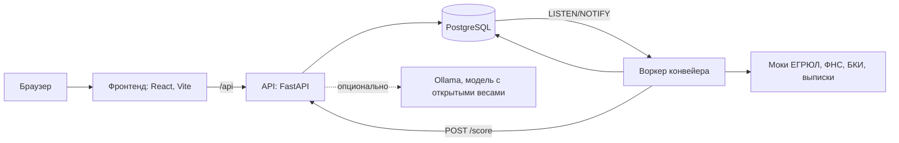

# Alpha-Bank-hackathon — умный кредитный кабинет

Цифровой кредитный конвейер для малого и микробизнеса. Предприниматель описывает задачу, получает подходящий продукт и проходит путь от заявки до денег на счёте. Банк обрабатывает заявку в том же продукте: автоматические проверки источников, скоринг, кредитные правила и консоль андеррайтера для ручного решения.

Что умеет прототип:

- **Клиент:** подбор продукта по задаче бизнеса, анкета с автозаполнением, загрузка документов, статус заявки в реальном времени, решение банка (одобрение, встречное предложение, запрос документов, отказ), подписание, кредит с графиком платежей, уведомления, ИИ-ассистент.
- **Банк:** очередь заявок с SLA, карточка заявки (проверки ЕГРЮЛ, ФНС, БКИ, выписки, скоринг, правила, рекомендация), решение андеррайтера, журнал аудита, состояние внешних источников.
- **Конвейер:** заявка проходит этапы сама, после отправки и после каждого решения статус у клиента обновляется без перезагрузки.

## Требования к окружению

| Компонент | Версия | Где зафиксирована |
| --- | --- | --- |
| Docker + Docker Compose | Docker 24+, Compose v2 | — |
| Python (бэкенд, моки) | 3.12 | `backend/.python-version`, `backend/Dockerfile`, `backend/uv.lock`, `mocks/uv.lock` |
| PostgreSQL | 16.4 | `docker-compose.yml` |
| Node.js (фронтенд) | 22.12+ (проверено на 22.14.0) | `frontend/.nvmrc`, `engines` в `frontend/package.json` |
| npm | 11 | `packageManager` в `frontend/package.json`, `frontend/package-lock.json` |

Для локального запуска бэкенда без Docker нужен [uv](https://docs.astral.sh/uv/).

## Запуск

Все компоненты — кабинет, API, воркер конвейера, моки и база — поднимаются одной командой из корня репозитория:

```bash
docker compose up --build
```

Откройте кабинет: <http://localhost:3000>.

| Адрес | Что там |
| --- | --- |
| <http://localhost:3000> | кабинет клиента и консоль банка (nginx, проксирует `/api` в API) |
| <http://localhost:8000/docs> | Swagger API |
| <http://localhost:8000/health> | проверка API |
| <http://localhost:8090> | моки внешних источников |

Если порт 5432 занят локальным Postgres, создайте `docker-compose.override.yml` (он в `.gitignore`):

```yaml
services:
  db:
    ports: !override
      - "5433:5432"
```

### Разработка фронтенда

Бэкенд в Docker, фронтенд с горячей перезагрузкой на <http://localhost:5173>:

```bash
cd frontend
npm ci
npm run dev
```

Начать с чистых данных: `docker compose down -v && docker compose up --build`.

### Без Docker

```bash
cd backend
uv sync
DATABASE_URL=sqlite:///./local.db uv run alembic upgrade head
DATABASE_URL=sqlite:///./local.db uv run uvicorn app.main:app --reload
```

Фронтенд без бэкенда, на встроенных моках: `cd frontend && VITE_API_MODE=mock npm run dev`.

## Тестовые учётные записи

Пароль у всех `demo123` (`DEMO_PASSWORD`). На экране входа пользователь выбирается кликом, пароль подставляется сам.

| Логин | Кто | Что показывает |
| --- | --- | --- |
| `igor.sokolov` | Игорь Соколов, ООО «Дом и уют» | ручное рассмотрение, встречное предложение, подписание |
| `anna.belova` | Анна Белова, ИП | автоматическое одобрение |
| `marina.orlova` | Марина Орлова, ООО «Лён и Дуб» | запрос дополнительных документов |
| `sergey.fomin` | Сергей Фомин, ИП | отказ с причиной |
| `olga.kravtsova` | Ольга Кравцова, андеррайтер | консоль банка |

## Сценарий проверки

1. Войдите как Анна → «Финансирование» → цель «Кассовый разрыв», 600 000 ₽ на 12 мес. → «Показать варианты» → «Оформить заявку».
2. Пройдите анкету, отметьте согласия, отправьте. Через несколько секунд заявка одобрена автоматически: откройте решение, примите условия, подпишите.
3. Войдите как Игорь, подайте заявку на 3 000 000 ₽ на 18 мес. Конвейер передаст её специалисту.
4. Войдите как Ольга: откройте заявку, посмотрите проверки, скоринг и правила, возьмите в работу и примите встречное предложение.
5. Вернитесь к Игорю: решение появится без перезагрузки. Примите его и подпишите — кредит появится в «Мои кредиты».

Чтобы этапы шли быстрее, откройте «Режим проверки» внизу меню и выберите быструю скорость конвейера. Там же можно «уронить» внешний источник и посмотреть, как заявка уходит на ручную проверку.

Сломать источник можно и без интерфейса — через админку моков; вернуть всё — `POST /demo/reset`:

```bash
curl -X POST localhost:8090/_admin/sources/bki -H 'content-type: application/json' -d '{"mode":"down"}'
```

Все сценарии подробно: [frontend/TESTING.md](frontend/TESTING.md). Ручная проверка API: [docs/manual-testing.md](docs/manual-testing.md).

## Архитектура



- **Фронтенд** (`frontend/`) — одностраничное приложение, кабинет клиента и консоль банка. Ходит в API через `/api`: в Docker его проксирует nginx, в разработке — Vite. Устройство кода: [frontend/README.md](frontend/README.md).
- **API** (`backend/`) — заявки, машина состояний, аудит, консоль андеррайтера, ассистент, режим проверки.
- **Воркер** — конвейер: полнота данных → внешние источники → скоринг → кредитные правила → решение или передача специалисту.
- **Моки** (`mocks/`) — локальные заменители внешних источников с режимами сбоев.

Подробно: [docs/architecture.md](docs/architecture.md), статусы и переходы: [docs/state-machine.md](docs/state-machine.md), модель данных: [docs/data-model.md](docs/data-model.md), контракты источников: [docs/integrations.md](docs/integrations.md).

## Переменные окружения

Бэкенд: пример со всеми значениями — [.env.example](.env.example).

| Переменная | По умолчанию | Назначение |
| --- | --- | --- |
| `POSTGRES_USER`, `POSTGRES_PASSWORD`, `POSTGRES_DB` | `cabinet` | база в Docker |
| `DATABASE_URL` | Postgres в Docker | подключение API и воркера к базе |
| `JWT_SECRET` | dev-значение | подпись токенов; при `APP_ENV` не `dev` обязателен свой |
| `ACCESS_TOKEN_EXPIRE_MINUTES` | `1440` | срок жизни токена |
| `APP_ENV` | `dev` | при `dev` включены эндпоинты режима проверки `/demo/*` |
| `DEMO_PASSWORD` | `demo123` | пароль тестовых пользователей |
| `UPLOAD_DIR`, `MAX_UPLOAD_SIZE` | `data/uploads`, 10 МБ | хранение загруженных документов |
| `CORS_ORIGINS` | `http://localhost:5173,http://localhost:4173` | адреса фронтенда |
| `SEED_ON_STARTUP` | `true` | создавать демо-пользователей и продукты при старте |
| `PIPELINE_MOCKS_URL` | `http://mocks:8090` | адрес моков источников |
| `PIPELINE_SCORING_URL` | `http://api:8000` | адрес скоринга; пусто — заглушка |
| `PIPELINE_SPEED` | `normal` | пауза между этапами: 5 с (`normal`) или 1 с (`fast`) |
| `PIPELINE_SOURCE_TIMEOUT_S` | `3` | таймаут одного запроса к источнику, секунды |
| `PIPELINE_SOURCE_ATTEMPTS` | `3` | попыток запроса к источнику |
| `PIPELINE_RETRY_PAUSE_S` | `0.5` | пауза между попытками, секунды |
| `PIPELINE_SAFETY_POLL_S` | `30` | как часто воркер сам проверяет очередь, если сигнал потерян |
| `ASSISTANT_MODE` | `auto` | `auto`, `llm` или `rules` |
| `ASSISTANT_OLLAMA_URL` | пусто | адрес Ollama; пусто — ассистент отвечает по правилам |
| `ASSISTANT_MODEL` | `qwen2.5:3b-instruct` | модель с открытыми весами |
| `ASSISTANT_TIMEOUT_S` | `30` | таймаут ответа модели, секунды |
| `FRONTEND_PORT` | `3000` | порт кабинета в Docker |

Фронтенд: пример — [frontend/.env.example](frontend/.env.example). Все `VITE_*` попадают в собранный JS, секреты в них не кладут. В Docker они передаются при сборке образа (`build.args` сервиса `frontend`): демо-функции там включены, пароль берётся из `DEMO_PASSWORD`. Для сборки без демо-функций: `VITE_FEATURE_DEMO=false docker compose up --build`.

| Переменная | По умолчанию | Назначение |
| --- | --- | --- |
| `VITE_API_MODE` | `api` | `api` — бэкенд через `/api`; `mock` — встроенные моки без бэкенда |
| `VITE_FEATURE_DEMO` | включён в `npm run dev` и в Docker, выключен в `npm run build` | быстрый выбор тестовых пользователей и «Режим проверки» |
| `VITE_DEMO_PASSWORD` | пусто | пароль для быстрого входа; задаётся только для разработки и демо-стенда |

## Структура

| Путь | Что там |
| --- | --- |
| `frontend/` | кабинет клиента и консоль банка: React, TypeScript, Vite |
| `backend/` | API, воркер конвейера, миграции, тесты |
| `mocks/` | моки внешних источников |
| `scoring/` | описание скоринговой модели |
| `seeds/` | синтетические демо-данные |
| `docs/` | архитектура, OpenAPI, модель данных, машина состояний, коллекция запросов Bruno |
| `Концепция/` | продуктовая концепция и исследование |
| `Дизайн-система/` | токены и компоненты дизайна |
| `app/` | ранний макет интерфейса, не используется — рабочий фронтенд в `frontend/` |

## Документация

- OpenAPI: [docs/openapi.json](docs/openapi.json), Swagger — <http://localhost:8000/docs>
- Коллекция запросов Bruno: [docs/collection](docs/collection)
- Архитектура: [docs/architecture.md](docs/architecture.md)
- Машина состояний заявки: [docs/state-machine.md](docs/state-machine.md)
- Модель данных: [docs/data-model.md](docs/data-model.md)
- Тестовые сценарии: [frontend/TESTING.md](frontend/TESTING.md), [docs/manual-testing.md](docs/manual-testing.md)
- Сторонние компоненты и смоделированные интеграции: [THIRD_PARTY_NOTICES.md](THIRD_PARTY_NOTICES.md)

## Проверки

```bash
cd backend
uv run ruff check .
uv run pytest
uv run python scripts/export_openapi.py
```

```bash
cd frontend
npm run lint
npm run build
```
