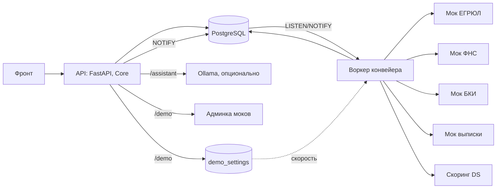

# Архитектура

## Путь заявки

`submitted` → `processing` → итог (`approved`, `rejected`, `manual_review`, `client_action`, `counter_offer`).
Клиент подаёт заявку, API шлёт `NOTIFY`, воркер забирает её и переводит в `processing`.
Все статусы и переходы: [state-machine.md](state-machine.md).

## Что делает пайплайн

1. Полнота: есть ИНН, продукт, сумма, срок, согласие на запрос в БКИ. Не хватает — статус `client_action`.
2. Источники: ЕГРЮЛ, ФНС, БКИ, выписка. Таймаут одного запроса 3 с, 3 попытки. Контракты: [integrations.md](integrations.md).
3. Скоринг: запрос в DS `/score`. Если `PIPELINE_SCORING_URL` пуст, берётся заглушка (640, класс B).
4. Правила из `backend/app/rules/rules.yaml`: пороги меняются без правки кода. Результат — статус, решение и рекомендация андеррайтеру.

Между этапами пауза: 5 с в режиме `normal`, 1 с в режиме `fast` (`PIPELINE_SPEED`). Так этапы видно на экране.

## Отказоустойчивость

- Источник не ответил или вернул ошибку: заявка уходит в `manual_review` с пометкой «Источник недоступен». Заявка не теряется и не падает.
- Скоринг не ответил: тоже `manual_review`.
- Сбой внутри пайплайна: заявка уходит в `manual_review`, ошибка пишется в лог.
- Воркер упал посреди работы: при старте `recover_stuck` находит заявки в `processing` и обрабатывает их заново.
- Заявки забираются через `SELECT ... FOR UPDATE SKIP LOCKED`, одну заявку не возьмут дважды. `NOTIFY` только будит воркер; если сигнал потерян, воркер проверяет очередь сам каждые 30 с.

## Режим жюри

Экран `/demo` (эндпоинты `/demo/*`):

- сбой источника включается через админку моков (`/_admin/sources`): `ok`, `warn` (медленно), `fail` (ошибка), `unavailable` (не отвечает);
- скорость конвейера хранится в таблице `demo_settings`, воркер читает её при старте каждой заявки;
- `reset` возвращает источники и скорость к началу.

Если сервис моков не отвечает, API возвращает 503 `mocks_unavailable`.

## Ассистент

Эндпоинт `/assistant`. Числа (остаток, платёж, статус, причина решения) ассистент берёт только из сервисов бэкенда через инструменты, сам их не придумывает.

Режимы (`ASSISTANT_MODE`):

- `rules` — ответы по правилам, без модели;
- `llm` — открытая модель через Ollama, при ошибке 503;
- `auto` (по умолчанию) — модель, если задан `ASSISTANT_OLLAMA_URL`, иначе или при ошибке модели — правила.

Ollama в `docker-compose` не входит: ассистент принимает только адрес API Ollama (`ASSISTANT_OLLAMA_URL`). Без него работает режим правил.
