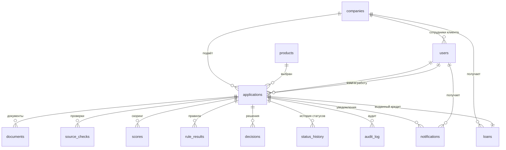

# Модель данных

Деньги — целые рубли (`BIGINT`), ставка — `FLOAT` (не деньги), JSON — `JSON`.

## Таблицы

| Таблица | Назначение | Ключевые поля |
| --- | --- | --- |
| `companies` | Компании клиентов | ИНН, ОГРН, тип (ООО/ИП), название, регистрация, ОКВЭД, адрес, руководитель, телефон |
| `users` | Вход и роли | логин, хэш пароля, роль `client`/`underwriter`, ФИО, компания |
| `products` | Каталог продуктов | код, лимиты суммы и срока, ставка, залог, срок решения |
| `applications` | Заявка | номер `2026-10-0142`, компания, продукт, сумма, срок, цель, код задачи, «нужны к», источник возврата, согласия, статус, метки, даты |
| `documents` | Файлы заявки | тип, имя, путь, MIME, размер, статус проверки, кто и когда загрузил |
| `source_checks` | Проверки источников | `egrul`, `fns`, `bki`, `statement`; `ok/warn/fail/unavailable`; ответ JSON, время, попытки |
| `scores` | Скоринг | балл, класс A–E, версия модели, факторы JSON |
| `rule_results` | Кредитные правила | код, значение, порог, пройдено, комментарий |
| `decisions` | Решение банка | исход, сумма, срок, ставка, платёж, запрошенные документы, сообщение клиенту, причина отказа, внутренний комментарий, кто решил |
| `status_history` | История переходов | из статуса, в статус, роль и id участника, комментарий, время |
| `audit_log` | Журнал аудита | время, тип и id участника, заявка, действие, `before`/`after` JSON |
| `notifications` | Уведомления клиента | пользователь, заявка, текст, тип, прочитано, создано |
| `loans` | Выданные кредиты | заявка, компания, сумма, срок, ставка, платёж, график JSON, дата выдачи |

## Правила

- Статус заявки меняется только через `app.state.machine.transition`.
- Персональные данные в `audit_log` маскируются при записи: `45 •• ••••12`.
- Номер заявки уникален и генерируется по месяцу подачи.
- Один кредит на заявку (`loans.application_id` уникален).
