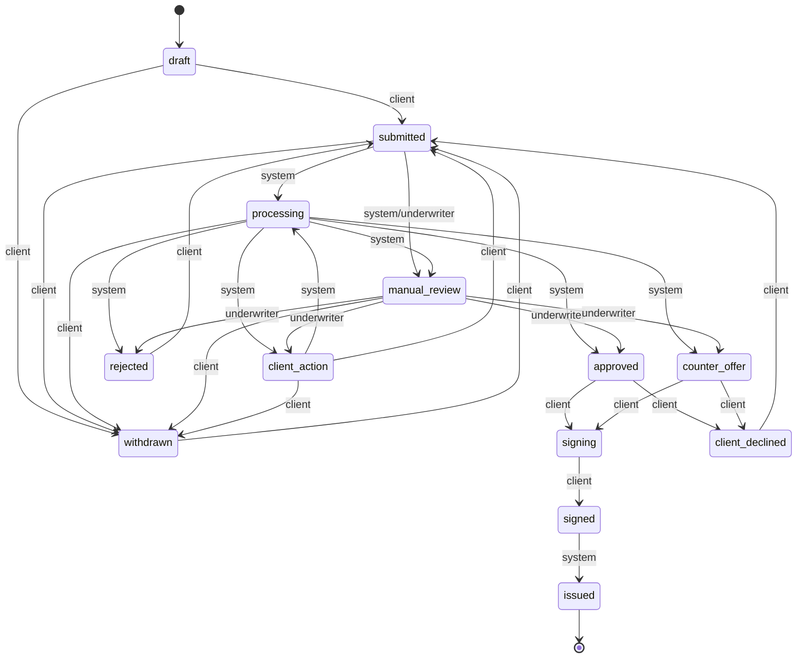

# Машина состояний заявки

Единственная точка смены статуса — `app.state.machine.transition`. Конвейер Интеграций,
консоль андеррайтера и клиентские эндпоинты обязаны звать её, а не писать `application.status`.

```python
from app.models import ApplicationStatus
from app.state.machine import Actor, ActorType, transition

transition(
    db,
    application,
    ApplicationStatus.processing,
    Actor(ActorType.system, None, "Конвейер"),
    {"comment": "Проверки источников завершены"},
)
```

- `db` — активная SQLAlchemy-сессия.
- `actor` — `Actor(ActorType.client | system | underwriter, id, name)`.
- `payload` — необязательный словарь: `comment`, `labels`.
- функция проверяет переход и роль, меняет статус, пишет `status_history` и `audit_log`,
  создаёт уведомление клиенту для видимых статусов;
- недопустимый переход — `ApiError(409, "invalid_transition")`;
- допустимый переход не для той роли — `ApiError(403, "forbidden")`;
- коммит делает вызывающий код.

## Статусы

| Код | Подпись | Что значит |
| --- | --- | --- |
| `draft` | Черновик | заполняется клиентом |
| `submitted` | Подана | ждёт конвейер |
| `processing` | Проверяем данные | идут проверки и скоринг |
| `manual_review` | Ручное рассмотрение | смотрит андеррайтер |
| `client_action` | Ждёт клиента | запрошены документы |
| `approved` | Одобрено | предложение банка |
| `counter_offer` | Встречное предложение | изменены условия |
| `rejected` | Отказ | решение банка |
| `signing` | Подписание | клиент принял условия |
| `signed` | Подписано | документы подписаны |
| `issued` | Выдано | кредит и график созданы |
| `client_declined` | Клиент отказался | отказ от предложения |
| `withdrawn` | Отозвана | клиент отозвал заявку |

## Переходы

| Из | В | Кто |
| --- | --- | --- |
| `draft` | `submitted`, `withdrawn` | client |
| `submitted` | `processing` | system |
| `submitted` | `manual_review` | system, underwriter |
| `submitted` | `withdrawn` | client |
| `processing` | `manual_review`, `client_action`, `approved`, `counter_offer`, `rejected` | system |
| `processing` | `withdrawn` | client |
| `manual_review` | `client_action`, `approved`, `counter_offer`, `rejected` | underwriter |
| `manual_review` | `withdrawn` | client |
| `client_action` | `processing` | system |
| `client_action` | `submitted` | client (после загрузки документа) |
| `client_action` | `withdrawn` | client |
| `approved`, `counter_offer` | `signing` | client |
| `approved`, `counter_offer` | `client_declined` | client |
| `signing` | `signed` | client |
| `signed` | `issued` | system |
| `rejected`, `client_declined`, `withdrawn` | `submitted` | client (повторная подача) |

Запрещены, в частности, `draft → approved` и `rejected → signed` — оба дают 409.



## Рекомендация пайплайна

Воркер пишет рекомендацию в `applications.recommendation` (JSON) в той же транзакции, что и смена статуса:

```json
{
  "outcome": "approve | counter | request | decline | null",
  "reason": "текст для андеррайтера (его показывает recommendation_for)",
  "score": 640,
  "class": "B",
  "kind": "none | counter_offer | reduce_amount | request_data",
  "amount": 2400000,
  "term_months": 18,
  "documents": ["..."],
  "explanation": "текст для андеррайтера",
  "payment_rub": 196460,
  "share": 0.3221
}
```

`amount` и `term_months` заполнены только для `kind = counter_offer`, иначе `null`. `documents` — запрошенные документы (пустой список, если не запрашивали). Если `outcome = null`, рекомендация считается по правилам и скорингу как раньше.

Текст рекомендации видит только андеррайтер. В `status_history.comment` пайплайн пишет текст для клиента: «Передана специалисту» при ручном рассмотрении, «Нужны документы: ...» при запросе документов, причину отказа при отказе.
