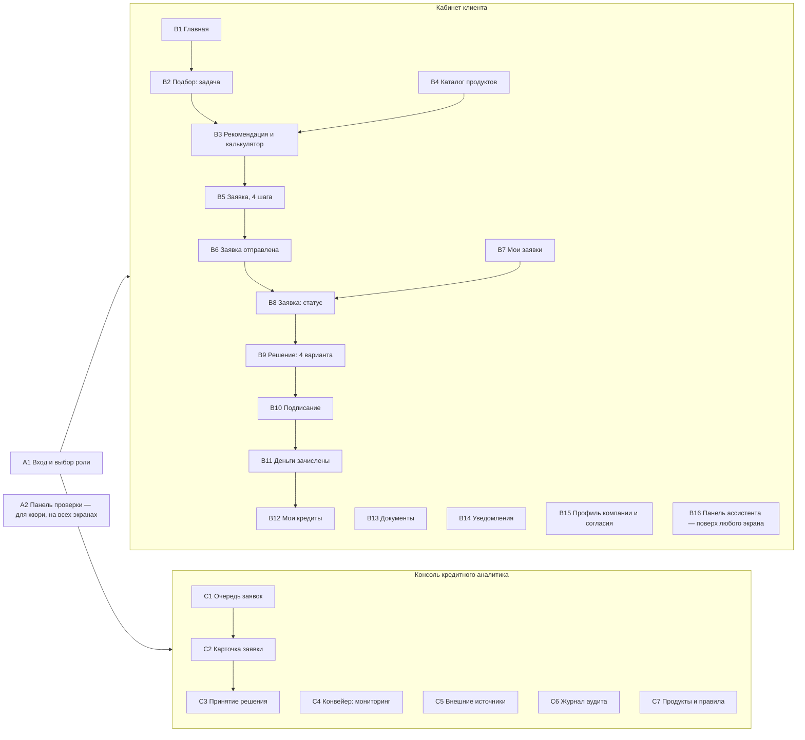
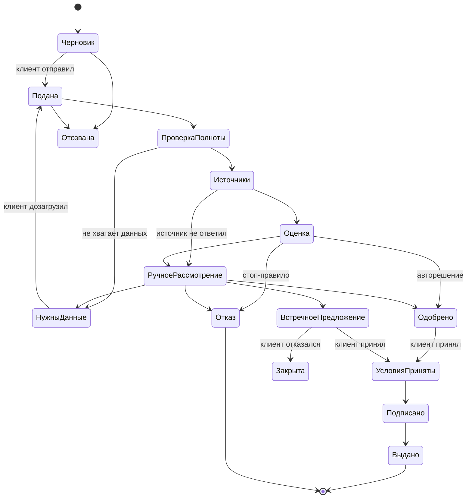

# Кредитный кабинет предпринимателя — карта экранов и бриф для макета

Версия 1 · 19 октября 2026 · хакатон Альфа-Банка, кейс «Умный кредитный кабинет»

## 0. Задание для Claude Design

Сделай первый кликабельный макет веб-продукта «Кредитный кабинет» по этой карте. Это не только кабинет клиента: продукт объединяет клиентский путь и внутреннюю обработку заявки банком в один процесс. Поэтому в макете две стороны одной заявки:

1. **Кабинет клиента** — предприниматель подбирает продукт, подаёт заявку и видит её путь до денег.
2. **Консоль кредитного аналитика** — сотрудник банка видит ту же заявку, результаты проверок и оценки и принимает решение.

Плюс экран входа с тестовыми учётными записями и «Панель проверки» для жюри.

Что нужно на выходе:

- Все экраны с приоритетом P0 и P1 из раздела 4, desktop 1440 px.
- Мобильные версии 390 px для экранов клиента, отмеченных «📱» (консоль банка — только desktop).
- Все состояния, перечисленные у каждого экрана (пустое, загрузка, ошибка, варианты решения).
- Переходы между экранами по сценариям из раздела 3, чтобы прототип можно было прокликать от входа до выдачи денег.
- Только светлая тема (тёмная есть в токенах, но в первый макет не нужна).

Жёсткие ограничения из кейса, которые должны быть видны в макете:

- Только веб, никакого мобильного приложения: мобильная версия — это адаптивная вёрстка.
- Весь путь внутри продукта: никаких писем, SMS, звонков и мессенджеров. Уведомления — только в кабинете, подписание — в кабинете.
- Кредитное решение принимает банк, а не ИИ. Ассистент помогает, но не обещает одобрение.
- Все данные синтетические. Логотип Альфа-Банка и его фирменные иллюстрации не используем: название продукта — текстом «Кредитный кабинет».

## 1. Дизайн-система

Используй приложенную дизайн-систему «Кредитный кабинет» (файлы `tokens.css`, `README.md`, `components/src/index.tsx`, скриншоты компонентов). Ниже — выжимка, если файлы не приложены.

**Характер.** Строгий и светлый: белые карточки на сером фоне, графитовый текст, один красный акцент на экран — только для главного действия, текущего шага или метки «Рекомендуем». Без градиентов, без цветных полос по краю карточек, тени редкие.

**Токены.**

| Назначение | Токен | Значение (светлая) |
| --- | --- | --- |
| Фон экрана | `bg` | #f2f3f5 |
| Карточки, панели | `surface` | #ffffff |
| Утопленные строки, ховер | `surface-muted` | #f7f7f8 |
| Основной текст | `ink` | #121214 |
| Второстепенный текст | `ink-secondary` | #5c6068 |
| Разделители / границы полей | `line` / `line-strong` | #e3e4e8 / #858a92 |
| Фирменный красный (графика от 24 px) | `brand` | #ef3124 |
| Главная кнопка | `accent` / `accent-hover` | #d21f16 / #b31a12 |
| Фон совета ассистента | `accent-soft` | #fdedec |
| Статусы | `success` / `warning` / `danger` / `info` | #127a42 / #9a5b00 / #c41a14 / #1f5fbf |
| Фоны статусов | `*-soft` | #e7f5ec / #fff4de / #fdecea / #e9f1fd |

- Шрифт Golos Text. Стили: `display` 40/44 800, `title-1` 32/40 700, `title-2` 24/32 700, `title-3` 20/28 600, `body` 15/22, `body-sm` 13/18, `label` 13/18 500, `caption` 12/16 600; суммы — `amount-xl` 36/40 700, `amount-lg`, `amount-md`, цифры моноширинные.
- Отступы шагом 4 px; внутри карточки 24 px, между карточками 16 px, между разделами 32–40 px.
- Радиусы: 12 px — кнопки и поля, 16 px — карточки, 24 px — пузыри чата и панели, полное скругление — Chip и Badge.
- Сетка desktop: левая навигация 248 px, контент до 1120 px, правая панель ассистента 400 px, 12 колонок, промежуток 24 px. Планшет от 768 px: навигация в иконки, ассистент выезжает поверх. Мобильный: нижняя навигация, ассистент — полноэкранная шторка, главная кнопка во всю ширину внизу, поля 16 px.

**Готовые компоненты** (использовать их, не рисовать заново): `Button` (primary / secondary / ghost / link), `Chip`, `TextField` (с меткой «Заполнено ассистентом» — `prefilled`), `Badge`, `Card` (в том числе `tone="accent"` для совета ассистента), `MetricTile`, `PaymentLoadMeter` (шкала «платёж как доля денежного потока»: безопасно / на грани / высокая нагрузка), `ProductCard`, `Stepper`, `StatusTracker`, `ChatMessage`, `ChatComposer`, `Alert` (info / success / warning / danger / assistant), `DocumentUpload`, `Icon` (20 линейных иконок: sparkle, arrow-up, arrow-down, paperclip, document, upload, check, check-circle, clock, alert, info, x, x-circle, chevron-right, wallet, calendar, shield, circle, trend-up, trend-down).

**Новые компоненты, которых нет в системе** — нарисовать в том же стиле и вынести на отдельную страницу «Новые компоненты»:

| Компонент | Где нужен |
| --- | --- |
| Боковая навигация (клиент и банк) и нижняя навигация (мобильный) | Все экраны |
| Шапка с колокольчиком уведомлений, именем компании и переключателем «Компания» | Все экраны клиента |
| Таблица с сортировкой, фильтрами и пагинацией | Мои заявки, Очередь заявок, Журнал аудита |
| Вкладки (Tabs) | Карточка заявки в банке |
| Модальное окно и боковая шторка (Drawer) | Подтверждение решения, подписание, предпросмотр документа |
| Слайдер суммы и срока | Подбор, калькулятор |
| Сегментированный переключатель | Выбор исхода решения в консоли |
| Список факторов оценки (горизонтальные столбики «+» и «−» от нуля) | Скоринг в консоли, «Почему такое решение» у клиента |
| Шкала балла (0–1000) с классом риска | Скоринг в консоли |
| Строка проверки источника (название, статус, время ответа, раскрытие деталей) | Внешние проверки |
| Таймер SLA | Очередь, карточка заявки |
| Тост-уведомление | Смена статуса заявки в реальном времени |
| Скелетон загрузки и пустое состояние | Все списки |
| Чекбокс согласия с раскрываемым текстом | Заявка, профиль |
| Поле кода подтверждения (6 ячеек) | Подписание |
| Таблица графика платежей | Решение, Мои кредиты |

**Голос.** На «вы» со строчной, фраза до 12–15 слов, кнопка начинается с глагола, без восклицательных знаков и эмодзи, без банковского жаргона в кабинете клиента («скоринг», «андеррайтинг» — только в консоли банка). Ассистент говорит в настоящем и будущем времени: «Посмотрю обороты», «Предлагаю кредитную линию». Ошибка = что случилось + что делать. Суммы — «1 500 000 ₽», проценты — «21,5%», даты словами — «28 октября».

## 2. Карта продукта

**Навигация клиента** (левая колонка desktop / нижняя на мобильном): Главная · Финансирование · Мои заявки · Мои кредиты · Документы. В шапке: уведомления, профиль компании, кнопка «Ассистент» со знаком sparkle. На мобильном нижняя навигация — 5 пунктов, «Документы» уходят в профиль, ассистент — плавающая кнопка.

**Навигация банка** (левая колонка): Очередь заявок · Конвейер · Внешние источники · Журнал аудита · Продукты и правила. В шапке: имя и роль сотрудника («Ольга Кравцова, кредитный аналитик»), поиск по ИНН или номеру заявки.

**Маршруты** (для фронтенда):

| Экран | Маршрут |
| --- | --- |
| A1 Вход | `/login` |
| B1 Главная | `/` |
| B2 Подбор | `/financing` |
| B3 Рекомендация | `/financing/offers` |
| B4 Каталог | `/financing/products` |
| B5 Заявка | `/applications/:id/edit?step=1..4` |
| B6 Отправлена | `/applications/:id/sent` |
| B7 Мои заявки | `/applications` |
| B8 Статус заявки | `/applications/:id` |
| B9 Решение | `/applications/:id/decision` |
| B10 Подписание | `/applications/:id/sign` |
| B11 Деньги зачислены | `/applications/:id/issued` |
| B12 Мои кредиты | `/loans` |
| B13 Документы | `/documents` |
| B14 Уведомления | `/notifications` |
| B15 Профиль | `/profile` |
| C1 Очередь | `/bank/queue` |
| C2 Карточка заявки | `/bank/applications/:id` |
| C4 Конвейер | `/bank/pipeline` |
| C5 Источники | `/bank/integrations` |
| C6 Аудит | `/bank/audit` |
| C7 Правила | `/bank/rules` |

## 3. Сквозные сценарии

Прототип должен прокликиваться по каждому сценарию. Главный — сценарий 1.

1. **Игорь: встречное предложение (главный).** Вход как Игорь → Главная, совет ассистента «Через 12 дней возможен кассовый разрыв» → «Подобрать финансирование» → пишет задачу своими словами ассистенту, отвечает на 2 уточнения чипами → Рекомендация: кредитная линия, 3 000 000 ₽ попадает в зону «на грани», ассистент предлагает безопасную сумму 2 400 000 ₽ → Игорь всё равно оформляет на 3 000 000 ₽ → Заявка: шаги 1–3 предзаполнены из счёта и ЕГРЮЛ, ассистент находит, что не хватает согласия на запрос в БКИ → Отправлена → Статус: этапы проходят вживую → Вход как аналитик → Очередь → Карточка заявки Игоря: проверки в источниках, оценка, правила, система советует «встречное предложение» → аналитик подтверждает 2 400 000 ₽ на 18 мес. → Вход как Игорь → тост «Решение готово» → Решение «Предложение банка» с сравнением «вы просили / банк предлагает» → Принять → Подписание в кабинете → Деньги зачислены → Мои кредиты.
2. **Анна: автоматическое одобрение.** Подбор через выбор цели без ассистента → овердрафт 500 000 ₽ → короткая заявка → все проверки зелёные, решение принято автоматически без аналитика → Одобрено → Подписание → Зачислено.
3. **Марина: банк запрашивает данные.** Заявка на кредит 4 500 000 ₽ → аналитик выбирает «Запросить данные» с чек-листом документов → у Марины статус «Нужны документы», уведомление → экран дозапроса, загрузка бухгалтерской отчётности и выписки из другого банка → повторная отправка → заявка возвращается в конвейер.
4. **Сергей: отказ с объяснением.** Заявка на кредит 1 500 000 ₽ → в кредитной истории просрочка больше 60 дней → правило отсекает → Отказ: причина простыми словами, что можно сделать, альтернатива и план «что улучшить за 3 месяца».
5. **Сбой источника (отказоустойчивость).** В Панели проверки отключить «Бюро кредитных историй» → новая заявка не падает: этап «Проверка в источниках» помечен «БКИ не ответило, заявка передана специалисту» → в консоли заявка в очереди с меткой «Источник недоступен», на экране Внешние источники — БКИ красный, в журнале аудита — событие.

## 4. Экраны

Приоритет: **P0** — обязательно в первом макете, **P1** — тоже рисуем сейчас, **P2** — если хватит места. 📱 — нужна мобильная версия.

### A. Общие

#### A1. Вход и выбор роли — P0 📱

Назначение: жюри и команда заходят под тестовыми учётками без регистрации.

- Слева — название «Кредитный кабинет», одна строка о продукте.
- Справа — две вкладки: «Клиент» и «Сотрудник банка».
- Под ними — карточки тестовых пользователей с ожидаемым исходом: «Игорь Соколов, ООО „Дом и уют“ — встречное предложение», «Анна Белова, ИП — автоматическое одобрение», «Марина Орлова, ООО „Лён и Дуб“ — банк запросит документы», «Сергей Фомин, ИП — отказ с альтернативой», «Ольга Кравцова — кредитный аналитик». Клик по карточке подставляет логин и пароль.
- Поля «Логин» и «Пароль», кнопка «Войти».
- Строка внизу: «Все данные синтетические. Демонстрационная версия».
- Состояния: ошибка «Неверный логин или пароль — проверьте раскладку», загрузка в кнопке.

#### A2. Панель проверки — P0

Назначение: жюри само проверяет сценарии без команды. Плавающая кнопка «Режим проверки» в левом нижнем углу на всех экранах; открывает шторку справа.

- Метка сверху: «Инструмент проверки. В рабочем продукте его нет».
- «Войти как»: список тестовых пользователей.
- «Скорость конвейера»: обычная / быстрая (этапы по 3 секунды).
- «Внешние источники»: переключатели ЕГРЮЛ/ЕГРИП, ФНС «Прозрачный бизнес», Бюро кредитных историй, выписка по счёту — «работает / не отвечает».
- «Ассистент»: языковая модель / упрощённый режим на правилах.
- «Сбросить демо-данные» (с подтверждением).
- Ссылки: Swagger API, README, диаграмма состояний.

### B. Кабинет клиента

Общее для всех экранов клиента: левая навигация, шапка, правая панель ассистента (свёрнута до кнопки или открыта). Совет ассистента на экране — `Alert tone="assistant"` или `Card tone="accent"`, всегда со знаком sparkle.

#### B1. Главная — P0 📱

Назначение: деньги бизнеса сейчас и ближайшее действие.

- Приветствие `display`: «Добрый день, Игорь». Подпись: «ООО „Дом и уют“ · данные по счёту на 24 октября, 10:42».
- Ряд `MetricTile`: «Остаток на счёте» 1 240 500 ₽; «Поступления за 30 дней» 3 860 000 ₽, +12% к сентябрю; «Чистый денежный поток» 610 000 ₽ в месяц; «Платежи по кредитам» 38 000 ₽ в месяц.
- График поступлений и списаний за 6 месяцев (столбики по месяцам) с заметной сезонностью.
- Совет ассистента: «Через 12 дней возможен кассовый разрыв: выплата от маркетплейса придёт 6 ноября, а закупка нужна до 1 ноября». Кнопка «Подобрать финансирование».
- Блок «Активная заявка»: компактный `StatusTracker` (3 ближайших этапа) и ссылка «Открыть заявку». Если заявок нет — карточка «Подобрать финансирование под задачу».
- Блок «Ближайшие события»: последние 3 уведомления.
- Состояния: скелетон загрузки; «Нет данных по счёту — подключите выписку»; есть активная заявка / нет заявок.

#### B2. Подбор финансирования: задача — P0 📱

Назначение: клиент формулирует задачу словами бизнеса, а не выбирает продукт банка.

- Заголовок «Для чего нужны деньги?».
- Два равноправных пути на одном экране:
    1. **Описать своими словами** — большое поле ассистента с примерами-чипами: «Закупить товар к сезону», «Не хватает на зарплату до поступления выручки», «Купить оборудование», «Выиграли тендер».
    2. **Выбрать цель** — 5 карточек задач с иконками: Кассовый разрыв · Пополнить оборот · Развитие и оборудование · Тендер и контракт · Рефинансировать кредиты. Под гарантией и лизингом метка «Скоро».
- После выбора — уточнения по одному вопросу за раз (или в диалоге с ассистентом, или формой): сумма — слайдер с полем ввода; когда нужны деньги — даты-чипы; на какой срок; из чего планируете вернуть — чипы «Выручка с маркетплейсов», «Оплата по контракту», «Текущая выручка»; есть ли залог — да/нет.
- Справа — сводка «Что поняли о задаче»: цель, сумма, срок, дата; каждое поле можно поправить.
- Кнопка «Показать варианты».
- Состояния: ассистент печатает; ассистент работает в упрощённом режиме (плашка `info`: «Ассистент сейчас отвечает по шаблонам. Подбор работает как обычно»).

#### B3. Рекомендация и калькулятор — P0 📱

Назначение: что брать, почему и сколько это стоит бизнесу. Главный экран ценности для клиента.

- Заголовок «Варианты под закупку к распродаже».
- `ProductCard` с меткой «Рекомендуем»: «Кредитная линия» · «Закупки партиями, деньги нужны многократно» · лимит 3 000 000 ₽ · срок 18 мес. · ставка 21,5% · платёж около 196 500 ₽ в месяц. Причины: «Выручка приходит волнами раз в 2 недели», «За год 5 закупок партиями», «Берёте только нужную часть лимита».
- Внутри — `PaymentLoadMeter`: платёж 196 500 ₽ из потока 610 000 ₽ = 32%, зона «на грани».
- Совет ассистента под карточкой: «При 2 400 000 ₽ платёж будет 157 200 ₽ — 26% потока, комфортная нагрузка». Кнопка «Пересчитать на 2 400 000 ₽».
- Вторая `ProductCard` — альтернатива: «Кредит на любые цели», 3 000 000 ₽, 24 мес., 22,9%, платёж около 157 000 ₽.
- Калькулятор (раскрывающийся блок): слайдеры суммы и срока → платёж, переплата, шкала нагрузки обновляются сразу.
- Раскрывающийся блок «Почему не другой продукт?»: овердрафт — «лимит меньше нужной суммы»; кредит на любые цели — «разовая выдача, а закупки у вас регулярные».
- Таблица «Сравнить продукты»: лимит, срок, ставка, платёж, скорость решения, нужен ли залог.
- Сноска на каждой карточке: «Предварительная оценка по данным вашего счёта. Решение принимает банк».
- Главная кнопка «Оформить заявку» — на рекомендованной карточке.
- Состояния: подходящих продуктов нет (объяснение и что изменить в запросе); сумма выше лимитов продукта.

#### B4. Каталог продуктов — P1

Назначение: тем, кто знает, что хочет. Карточки 5 продуктов: Овердрафт, Кредитная линия, Кредит на любые цели — активны; Банковская гарантия, Лизинг — с меткой «Скоро». На каждой: для какой задачи, лимит, срок, ставка «от», требования (возраст бизнеса от 12 месяцев и т. д.), кнопка «Рассчитать».

#### B5. Заявка: мастер из 4 шагов — P0 📱

Назначение: минимум ручного ввода, проверка полноты до отправки. Сверху `Stepper`: Параметры · Компания · Финансы и документы · Проверка и отправка. Справа — сводка заявки и подсказки ассистента. Внизу — «Черновик сохранён в 10:42» (автосохранение) и кнопки «Назад» / «Продолжить».

- **Шаг 1. Параметры.** Продукт, сумма, срок, цель, дата, к которой нужны деньги, источник возврата. Всё предзаполнено из подбора, метка «Заполнено ассистентом».
- **Шаг 2. Компания.** ИНН, ОГРН, полное название, дата регистрации, ОКВЭД, юридический адрес, руководитель — с меткой «Из ЕГРЮЛ», только для чтения с кнопкой «Данные неверны». Контактное лицо и телефон для связи в кабинете. Согласия (чекбоксы с раскрываемым текстом): на запрос в бюро кредитных историй; на обработку персональных данных; на анализ операций по счёту.
- **Шаг 3. Финансы и документы.** Обороты за 12 месяцев — из счёта (мини-график, метка «Из выписки по счёту»). Действующие кредиты — список с суммами. `DocumentUpload` с чек-листом: что обязательно, что желательно. Для ООО — бухгалтерская отчётность за 2025 год; выписка из другого банка, если есть второй счёт. Статусы файлов: загружается / проверяем / принят / ошибка («Фото обрезано: не видно страницы с подписью. Загрузите разворот целиком»).
- **Шаг 4. Проверка и отправка.** Сводка всех полей блоками с кнопкой «Изменить». Совет ассистента, если чего-то не хватает: «Не отмечено согласие на запрос в БКИ — без него банк не сможет оценить заявку». Кнопка «Отправить заявку».
- Состояния: ошибка поля («У ООО в ИНН 10 цифр — здесь 8»); не все обязательные документы; черновик сохраняется; отправка (спиннер «Отправляем»).

#### B6. Заявка отправлена — P1 📱

Номер заявки «№ 2026-10-0142», что будет дальше (3 пункта: проверим данные, запросим сведения в источниках, примем решение), ожидаемое время «обычно до 2 часов», кнопка «Следить за заявкой». Строка: «Сообщим о решении здесь, в кабинете».

#### B7. Мои заявки — P0

Таблица или карточки: номер, продукт, сумма, дата подачи, статус (`Badge` со словом и иконкой), что от вас нужно. Фильтры: Активные · Черновики · Завершённые. Состояния: пусто («Заявок пока нет» и кнопка «Подобрать финансирование»), загрузка.

#### B8. Заявка: статус — P0 📱

Назначение: где заявка, сколько ждать, что дальше. Ответ на боль «не знаю, что с заявкой».

- Шапка: продукт, сумма, номер, `Badge` текущего статуса, «Подана 24 октября, 10:51».
- `StatusTracker` с этапами клиента: Заявка отправлена → Проверяем данные → Запрашиваем сведения (ЕГРЮЛ, ФНС, кредитная история) → Оцениваем заявку → Рассматривает специалист → Решение → Подписание → Деньги на счёте. У каждого этапа время, у текущего — ожидаемое время и пояснение.
- Этапы меняются вживую: тост «Заявка перешла к специалисту» без перезагрузки.
- Блоки: параметры заявки; документы; история событий (лента с датами).
- Варианты состояния, которые нужно нарисовать: идёт проверка; передана специалисту; «Нужны документы» (этап `attention` с кнопкой «Загрузить»); «Источник не ответил — заявку проверит специалист, это добавит до часа»; решение готово (кнопка «Посмотреть решение»).
- Кнопка второго уровня «Отозвать заявку» (с подтверждением).

#### B9. Решение — P0 📱, 4 варианта

Каждый вариант — свой экран. Один `display` на экран, крупная сумма `amount-xl`. В каждом — раскрывающийся блок «Почему такое решение» с 3 факторами простыми словами.

- **B9a. Одобрено.** «Банк одобрил овердрафт» · 500 000 ₽ (сценарий Анны) · условия сеткой (срок, ставка, платёж) · `PaymentLoadMeter` · график платежей (первые 3 строки + «Показать весь») · кнопка «Принять условия» · «Условия действуют до 31 октября».
- **B9b. Предложение банка (встречное).** «Банк готов выдать 2 400 000 ₽». Сравнение двумя колонками: «Вы просили» 3 000 000 ₽ · 18 мес. · платёж 196 500 ₽ · 32% потока — «Банк предлагает» 2 400 000 ₽ · 18 мес. · платёж 157 200 ₽ · 26% потока. Две шкалы нагрузки рядом. Объяснение: «Платёж на 3 000 000 ₽ занял бы треть вашего денежного потока. С этой суммой нагрузка комфортная». Кнопки «Принять предложение» и «Отказаться». Ссылка «Обсудить с ассистентом».
- **B9c. Нужны документы.** «Банку нужны ещё два документа». Чек-лист с объяснением каждого: «Бухгалтерская отчётность за 2025 год — чтобы увидеть выручку и долги компании целиком»; «Выписка из другого банка за 6 месяцев — без неё банк не увидит часть выручки». `DocumentUpload`, поле «Комментарий для специалиста», кнопка «Отправить на повторное рассмотрение». Строка: «Ответьте до 30 октября, иначе заявка закроется».
- **B9d. Отказ.** Заголовок без драматизации: «Сейчас банк не может выдать кредит». Причина простыми словами: «В кредитной истории есть просрочка больше 60 дней за последний год». Блок «Что можно сделать»: альтернатива (если есть) карточкой; план «Что улучшить за 3 месяца» — 3 пункта; «Подать заявку снова можно после 25 января». Кнопка «Посмотреть альтернативу» или «Поговорить с ассистентом».

#### B10. Подписание — P0 📱

Назначение: смоделированное подписание без реальных операций и без SMS.

- Список документов: кредитный договор, график платежей, заявление на выдачу — у каждого «Открыть» (предпросмотр в шторке).
- Чекбокс «Ознакомился с условиями».
- Подтверждение в кабинете: поле кода из 6 ячеек; код показан на этом же экране в плашке «Демо: код подтверждения 482 913» (вместо SMS).
- Кнопка «Подписать».
- Метка внизу: «Подписание смоделировано: юридической силы нет».

#### B11. Деньги зачислены — P1 📱

Успех: «2 400 000 ₽ на счёте» · счёт зачисления (маска •• 4821) · дата первого платежа · кнопки «Открыть график платежей» и «На главную». Строка «Выдача смоделирована, реального перевода нет».

#### B12. Мои кредиты — P1

Карточки действующих кредитов: продукт, остаток, ближайший платёж и дата, прогресс погашения. Внутри — график платежей таблицей. Совет ассистента, если платёж приходится на кассовый разрыв.

#### B13. Документы — P1

Все документы по заявкам и кредитам: название, к какой заявке, дата, статус проверки, действия «Открыть», «Скачать», «Заменить». Фильтр по заявке. Зона загрузки.

#### B14. Уведомления — P1

Лента внутри продукта, сгруппирована по дням: «Решение по заявке № 2026-10-0142 готово», «Банк запросил документы», «Условия действуют до 31 октября», «Платёж 15 ноября». Непрочитанные выделены. Колокольчик в шапке со счётчиком и выпадающим списком последних 5.

#### B15. Профиль компании и согласия — P2

Реквизиты из ЕГРЮЛ, контактные данные, подключённые счета, список выданных согласий с датой и кнопкой «Отозвать», настройки уведомлений в кабинете.

#### B16. Панель ассистента — P0 📱

Правая панель 400 px на desktop, полноэкранная шторка на мобильном. Ассистент знает, на каком экране клиент.

- Шапка: аватар (красный круг с белой звездой), «Ассистент», кнопка «Свернуть».
- Состояние «Начало»: приветствие и 3–4 чипа по контексту экрана («Подобрать финансирование», «Что с моей заявкой?», «Почему такая сумма?»).
- Диалог выявления потребности (сценарий Игоря):
    - Клиент: «Нужно закупить партию к распродаже 11.11, а выплата от маркетплейса только через две недели».
    - Ассистент: «Понимаю: нужны деньги на закупку до поступления выручки. Сколько планируете потратить на партию?» + чипы «1–2 млн ₽», «2–3 млн ₽», «Больше 3 млн ₽».
    - Клиент выбирает «2–3 млн ₽», уточняет «3 миллиона».
    - Ассистент: «Посмотрю обороты по счёту». Индикатор набора. Затем в `footer` сообщения — `MetricTile` «Чистый поток 610 000 ₽ в месяц» и `ProductCard` кредитной линии с `PaymentLoadMeter`.
- Карточки в сообщениях кликабельны и ведут на экран рекомендации.
- Под полем ввода всегда дисклеймер: «Ассистент помогает с выбором. Решение по заявке принимает банк».
- Состояния: печатает; упрощённый режим (языковая модель недоступна) — плашка и ответы шаблонами; ошибка сети с кнопкой «Повторить».

### C. Консоль кредитного аналитика

Только desktop. Плотнее, чем кабинет клиента: таблицы, вкладки, профессиональные термины допустимы («скоринг», «правила», «PD»). Тот же визуальный язык и токены.

#### C1. Очередь заявок — P0

- Счётчики по этапам вверху (кликабельные фильтры): Новые · В конвейере · Ручное рассмотрение · Ждут клиента · Решение принято сегодня.
- Таблица: номер, компания и ИНН, продукт, сумма, класс риска (Badge A–E), рекомендация системы, этап, SLA (таймер, жёлтый — меньше часа, красный — просрочен), метки («Источник недоступен», «Повторная подача»).
- Фильтры: продукт, сумма, класс риска, «Мои заявки». Поиск по ИНН или номеру.
- Состояния: пусто («Очередь разобрана»), загрузка, новая заявка появилась (подсветка строки).

#### C2. Карточка заявки — P0

Главный экран банковской стороны. Слева — содержимое по вкладкам, справа — закреплённая панель решения (C3).

- **Шапка.** ООО «Дом и уют», ИНН 7701234567 · заявка № 2026-10-0142 · кредитная линия 3 000 000 ₽ на 18 мес. · этап «Ручное рассмотрение» · SLA «осталось 1 ч 20 мин» · кнопка «Взять в работу».
- **Вкладка «Сводка».** Параметры заявки; цель словами клиента («закупка к распродаже»); итог проверок в одну строку на источник (зелёный / жёлтый / красный); рекомендация системы: «Встречное предложение: 2 400 000 ₽ на 18 мес. — доля платежа 32% выше порога 30%».
- **Вкладка «Клиент».** Данные компании, руководитель, возраст бизнеса, сотрудники; обороты по счёту за 12 месяцев (график); действующие обязательства. Паспортные данные маскированы («45 •• ••••12»).
- **Вкладка «Внешние проверки».** Строка на каждый источник с временем ответа и раскрытием деталей:
    - ЕГРЮЛ/ЕГРИП: статус «Действующее», зарегистрировано 12 июня 2024 года, ОКВЭД 47.91, руководитель Соколов И. А. — ок.
    - ФНС «Прозрачный бизнес»: налоговой задолженности нет, недостоверных сведений об адресе нет, доходы за 2025 год 44 800 000 ₽, среднесписочная численность 6 — ок.
    - Бюро кредитных историй: 1 действующий кредит в другом банке (остаток 450 000 ₽, платёж 38 000 ₽ в месяц), просрочек за 24 месяца нет, запросов истории за 30 дней — 2 — ок.
    - Выписка по счёту: средний чистый поток 610 000 ₽, сезонность высокая — внимание.
    - Состояние «Источник не ответил»: строка серо-красная, «БКИ не ответило за 10 секунд, 3 попытки. Проверьте вручную», кнопка «Запросить повторно».
- **Вкладка «Оценка риска».** Две раздельные части — это требование кейса: скоринг ≠ решение.
    - Скоринг: шкала балла 640 из 1000, класс риска B (умеренный), версия модели «scorecard v1.2». Список факторов с вкладом: «Стабильный оборот 12 месяцев» +48; «Нет просрочек» +35; «Долговая нагрузка 32% потока» −41; «Возраст бизнеса 2 года» −12; «Высокая сезонность выручки» −9.
    - Кредитные правила продукта: таблица правило → значение → результат. Сумма в лимите продукта — да; возраст бизнеса от 12 месяцев — да; нет налоговой задолженности — да; класс риска не ниже C — да; доля платежа не выше 30% — нет (32%). Итог правил: «Встречное предложение: подобрана сумма, при которой платёж 26% потока».
- **Вкладка «Документы».** Список с предпросмотром, статус проверки комплектности, кто загрузил и когда.
- **Вкладка «История».** Лента событий заявки: смена статусов (система или сотрудник), запросы к источникам, действия клиента — с точным временем.

#### C3. Панель решения — P0 (часть C2)

- Сегментированный переключатель исхода: Одобрить · Встречное предложение · Запросить данные · Отказать. По умолчанию выбран вариант, который рекомендует система, с меткой «Рекомендация системы».
- Одобрить: условия из заявки только для чтения.
- Встречное предложение: поля суммы, срока, ставки; под ними пересчёт платежа и `PaymentLoadMeter`.
- Запросить данные: чек-лист документов (бухгалтерская отчётность, выписка из другого банка, договор поставки, другое) и поле «Сообщение клиенту».
- Отказать: причина из справочника и поле «Объяснение для клиента» с готовым шаблоном простыми словами.
- Поле «Внутренний комментарий» (клиент его не видит).
- Кнопка «Принять решение» → модальное подтверждение «Клиент увидит решение сразу. Отменить нельзя».
- Состояние после решения: панель только для чтения, «Решение принято 24 октября, 11:32, О. Кравцова».

#### C4. Конвейер: мониторинг — P1

Назначение: показать, что процесс управляемый — это критерий enterprise. На синтетических данных.

- Плитки: заявок за неделю 128; доля автоматических решений 64%; среднее время до решения 2 ч 40 мин; ждут клиента 9.
- Воронка этапов: подано → проверка полноты → источники → оценка → решение → выдано.
- Распределение исходов: одобрено, встречное, дозапрос, отказ.
- Топ причин отказа и дозапроса.
- Блок «Состояние источников» — короткая версия C5.

#### C5. Внешние источники — P1

Таблица интеграций: ЕГРЮЛ/ЕГРИП, ФНС «Прозрачный бизнес», Бюро кредитных историй, выписка по счёту, сервис оценки. Для каждой: статус (работает / медленно / не отвечает), среднее время ответа, ошибки за час, последняя успешная проверка, правило при сбое («заявка уходит на ручную проверку»). Метка «Смоделированная интеграция» у каждой строки.

#### C6. Журнал аудита — P1

Таблица событий: время, кто (система / сотрудник / клиент), заявка, действие, было → стало. Фильтры по заявке, участнику, типу события. Персональные данные в журнале маскированы.

#### C7. Продукты и правила — P2

Только для чтения: каталог продуктов с параметрами и пороги правил (доля платежа 30%, минимальный класс риска C, возраст бизнеса 12 месяцев). Метка «Значения — допущения команды, требуют согласования с банком».

### D. Системные состояния (лист «Состояния»)

Нарисовать на одном листе: скелетоны загрузки (карточки, таблица), пустые состояния, ошибка сети («Нет связи с сервером. Проверим ещё раз через 10 секунд» + «Повторить»), сессия истекла («Войдите снова — черновик заявки сохранён»), 404, нет прав (клиент открыл ссылку консоли), тост смены статуса, модальное подтверждение.

## 5. Статусы заявки

Одна модель для обеих сторон; клиент и банк видят разные слова.

| Статус | Клиент видит | Банк видит | Badge |
| --- | --- | --- | --- |
| Черновик | Черновик | — | neutral |
| Подана | Заявка отправлена | Новая | info |
| Проверка полноты | Проверяем данные | Проверка полноты | info |
| Источники | Запрашиваем сведения | Запрос в источники | info |
| Оценка | Оцениваем заявку | Скоринг и правила | info |
| Ручное рассмотрение | Рассматривает специалист | Ручное рассмотрение | info |
| Нужны данные | Нужны документы | Ждёт клиента | warning |
| Одобрено | Одобрено | Одобрено | success |
| Встречное предложение | Предложение банка | Встречное предложение | warning |
| Отказ | Отказ | Отказ | danger |
| Условия приняты | Ждёт подписания | Ожидает подписания | info |
| Подписано | Документы подписаны | Подписано | success |
| Выдано | Деньги на счёте | Выдано | success |
| Отозвана / Закрыта | Отозвана | Отозвана клиентом | neutral |

## 6. Демо-данные

Все данные вымышленные. Дата демо — 24 октября 2026 года.

| Персона | Компания | Бизнес | Запрос | Исход |
| --- | --- | --- | --- | --- |
| Игорь Соколов | ООО «Дом и уют», ИНН 7701234567 | Товары для дома на маркетплейсах, 2 года 4 месяца, 6 сотрудников | Кредитная линия 3 000 000 ₽ на 18 мес. | Встречное предложение 2 400 000 ₽ |
| Анна Белова | ИП Белова А. С., ИНН 770212345678 | Кофейня, 2 точки, 4 года | Овердрафт 500 000 ₽ | Автоматическое одобрение |
| Марина Орлова | ООО «Лён и Дуб», ИНН 7703345678 | Мебельное производство, B2B | Кредит на любые цели 4 500 000 ₽ на 36 мес. | Банк запросил документы |
| Сергей Фомин | ИП Фомин С. В., ИНН 770498765432 | Шиномонтаж | Кредит на любые цели 1 500 000 ₽ | Отказ: просрочка больше 60 дней |
| Ольга Кравцова | — | Кредитный аналитик банка | — | — |

Продукты для демо (условия синтетические):

| Продукт | Задача | Лимит | Срок | Ставка от | Требования |
| --- | --- | --- | --- | --- | --- |
| Овердрафт | Кассовый разрыв | 100 000–5 000 000 ₽ | 12 мес. | 23% | Счёт в банке от 3 месяцев |
| Кредитная линия | Регулярные закупки, оборот | 500 000–30 000 000 ₽ | до 36 мес. | 21,5% | Бизнес от 12 месяцев |
| Кредит на любые цели | Разовая крупная трата | 300 000–50 000 000 ₽ | 12–60 мес. | 22,9% | Бизнес от 12 месяцев |
| Банковская гарантия | Тендер, контракт | — | — | — | Скоро |
| Лизинг | Оборудование, транспорт | — | — | — | Скоро |

## 7. Соответствие требованиям кейса

Проверочный список: каждое требование должно быть видно хотя бы на одном экране.

| Требование кейса | Где в макете |
| --- | --- |
| Клиент выбирает продукт и проходит путь от заявки до результата | B2 → B3 → B5 → B8 → B9 → B10 → B11 |
| Пользователь без банковской экспертизы понимает варианты, статус и дальнейшие действия | B2 (задача своими словами), B3 («Почему», нагрузка), B8 (ожидаемое время), B9 (причины простыми словами) |
| Этапы обработки со стороны банка и модель принятия решения | C1, C2, C3 |
| Обогащение из внешних источников: БКИ, ЕГРЮЛ/ЕГРИП, ФНС | B5 шаг 2 (предзаполнение из ЕГРЮЛ), C2 «Внешние проверки», C5 |
| Скоринг отделён от кредитного решения | C2 «Оценка риска»: скоринг и правила раздельно |
| Решение не бинарное: одобрение, другие условия, дозапрос, отказ | B9a–B9d, C3 |
| Данные сохраняются, состояние меняется последовательно и видно динамически | Автосохранение черновика B5, живой трекер и тосты B8, история C2 |
| Подписание и выдача смоделированы | B10, B11 с пометками |
| Весь путь внутри продукта, без почты и SMS | B14, колокольчик, код подтверждения на экране B10 |
| Веб-интерфейс, не мобильное приложение | Адаптив 📱 |
| ИИ только там, где он создаёт ценность | B16, отметки sparkle, упрощённый режим без модели |
| Безопасность, надёжность, сопровождение (enterprise) | Роли A1, маскирование данных C2 и C6, журнал аудита C6, сбой источника C2 и C5, мониторинг C4 |
| Решение можно проверить по сценарию, есть тестовые данные и учётки | A1, A2 |

## 8. Чего не рисовать

- Регистрацию, восстановление пароля, онбординг компании — у демо-пользователей всё уже есть.
- Реальные интеграции с госуслугами, ЭЦП, переводами денег.
- Новостную ленту.
- Сценарии гарантии и лизинга — только карточки «Скоро».
- Мобильную версию консоли банка.
